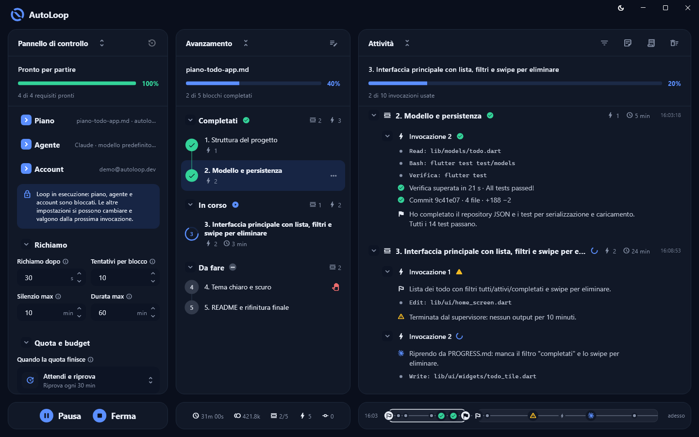

# AutoLoop

App desktop per Windows che porta avanti un piano di sviluppo in autonomia usando **Codex CLI** o **Claude Code**.
Scegli un file di testo con il piano, scegli la cartella di lavoro e premi *Avvia*: AutoLoop divide il piano in blocchi,
li assegna all'agente uno alla volta e lo richiama ogni volta che si ferma, finché il piano non è finito o la quota
non è esaurita.

È l'evoluzione del supervisore Python *Codex Autonomous Loop*, che eseguiva un unico piano JSON rigido.

Sito: [chiriacadrian2296.github.io/auto-loop](https://chiriacadrian2296.github.io/auto-loop/) · Download: [ultima versione](https://github.com/chiriacadrian2296/auto-loop/releases/latest)



## Come funziona

1. **Divisione in blocchi.** Il piano (`.md` o `.txt`) viene diviso automaticamente, in quest'ordine di preferenza:
   titoli Markdown (il livello più alto che compare almeno due volte; un `# Titolo` unico resta come introduzione),
   elenco numerato, checkbox (`- [x]` già spuntate contano come completate), elenco puntato. Se nessuna struttura
   regge, il piano è un blocco unico. Puoi forzare la strategia dalle impostazioni.
2. **Un'invocazione alla volta.** Ogni invocazione è una sessione nuova (`codex exec` / `claude -p`). L'agente riceve
   il piano intero come contesto, il blocco corrente, il contenuto di `.autoloop/PROGRESS.md` e l'esito
   dell'invocazione precedente.
3. **Memoria su disco.** L'agente aggiorna `.autoloop/PROGRESS.md` prima di terminare: è così che riprende il filo
   alla volta successiva.
4. **Esito dichiarato.** La risposta finale deve terminare con `AUTOLOOP_STATUS: DONE`, `CONTINUE` o
   `BLOCKED: <motivo>`.
   - `DONE`: verifica opzionale → commit git opzionale → blocco successivo.
   - `CONTINUE`, oppure l'agente si ferma senza esito: dopo il **richiamo** (30 s di default) viene rilanciato sullo
     stesso blocco.
   - `BLOCKED`: il loop va in pausa (o salta il blocco, se lo imposti).
5. **Watchdog.** Se l'agente resta in silenzio oltre il limite, o supera la durata massima, viene terminato con tutto
   l'albero di processi e richiamato.
6. **Quota.** Quando la CLI segnala il limite di utilizzo, AutoLoop si ferma oppure aspetta e riprova ogni N minuti
   (default). Un tentativo bloccato dalla quota non viene conteggiato. Un problema di login ferma sempre il loop.

Tutto lo stato è in `<cartella di lavoro>/.autoloop/` (con un `.gitignore` che lo esclude da git):
`state.json` (avanzamento, contatori), `PROGRESS.md` e `logs/` (per ogni invocazione: prompt, output grezzo, ultimo
messaggio). Chiudere l'app o premere *Ferma ora* non perde nulla: al riavvio riprende dal blocco in corso.

## Requisiti

- Windows 10/11.
- Almeno una CLI con login già fatto:
  - Codex: `codex login`. AutoLoop trova da solo anche la copia installata dall'app Codex in
    `%LOCALAPPDATA%\OpenAI\Codex\bin`.
  - Claude Code: `claude auth login` (oppure `claude setup-token` e la variabile `CLAUDE_CODE_OAUTH_TOKEN` per
    lavori lunghi senza supervisione). Viene cercato nel PATH, in `~/.local/bin` e nell'estensione VS Code.
- Per compilare: Flutter 3.47+ e **Visual Studio 2022** (o Build Tools) con il carico di lavoro
  *Sviluppo di applicazioni desktop con C++*.

## Compilare l'eseguibile

```powershell
flutter build windows --release
```

Il risultato è in `build\windows\x64\runner\Release\`. Per distribuirlo copia **l'intera cartella** (`AutoLoop.exe`
ha bisogno delle DLL e della cartella `data` accanto).

### Installer

```powershell
.\tool\build_installer.ps1
```

Compila la release e crea `build\installer\AutoLoop-Setup-<versione>.exe` (la versione viene da `pubspec.yaml`).
Serve [Inno Setup 6](https://jrsoftware.org/isinfo.php): `winget install JRSoftware.InnoSetup`. L'installer non chiede
i permessi di amministratore (installa per l'utente corrente, oppure per tutti se lo si sceglie), crea il collegamento
nel menu Start e si disinstalla da *Impostazioni → App*. Gli account e i profili in `%APPDATA%\AutoLoop` restano dopo
la disinstallazione.

Se dopo aver cambiato le icone dell'interfaccia alcune non compaiono nell'.exe, esegui `flutter clean` e ricompila:
in release Flutter include solo le icone usate, e una build incrementale può riusare il sottoinsieme vecchio.

## Account e profili

Il pannello **Account e CLI** (la scheda *Account* nelle impostazioni) mostra per Codex e Claude
il percorso della CLI, la versione e l'account collegato (email e piano), con *Accedi*, *Cambia account* ed *Esci*.
L'accesso si fa nella procedura ufficiale della CLI, in una finestra di terminale che si apre da sola.

Gli account sono organizzati in **profili**:

- **Account di sistema**: gli stessi accessi di Codex e Claude Code già installati sul computer. Uscire da qui
  scollega anche quelle app, e il pannello lo ricorda prima di farlo.
- **Profili creati da te** (es. "Lavoro", o uno per un'altra persona): ognuno ha accessi propri, salvati in
  `%APPDATA%\AutoLoop\profiles\<profilo>` tramite `CODEX_HOME` e `CLAUDE_CONFIG_DIR`. Non toccano gli account di
  sistema. Eliminando il profilo si cancellano anche i suoi accessi.

Il loop usa sempre il profilo selezionato, e il registro attività lo indica all'avvio.

## Impostazioni principali

| Impostazione | Effetto |
|---|---|
| Permessi dell'agente | *Protetta*: Codex con `--sandbox workspace-write`, Claude con `--permission-mode auto` (un classificatore approva le azioni sicure, come modifiche, build e test, e blocca quelle rischiose). In entrambi i casi l'agente può eseguire comandi. *Accesso completo*: nessuna sandbox e nessuna conferma. Da usare solo su progetti sotto git o con backup. |
| Richiamo dopo | Pausa tra un'invocazione e la successiva. |
| Silenzio max / Durata max | Limiti del watchdog per singola invocazione. |
| Tentativi per blocco | Oltre questo numero il blocco viene segnato come bloccato. |
| Quando la quota finisce | Fermati, oppure attendi e riprova. |
| Budget token | Limite complessivo (0 = nessun limite). |
| Comando di verifica | Comando `cmd.exe` (es. `flutter test`) che deve passare perché un `DONE` venga accettato; se fallisce, l'output torna all'agente. |
| Commit git a ogni blocco | `git add -A` + commit `autoloop: <titolo blocco>` se la cartella è un repository. |
| Istruzioni aggiuntive | Testo aggiunto a ogni prompt (stack, stile, cose da non toccare). |

## L'interfaccia

- **Impostazioni** (a sinistra): piano, agente, account, richiamo, verifica e regole. Ogni campo ha una ⓘ che spiega
  cosa fa. Mentre il loop gira, Piano, Agente e Account si chiudono e non si possono cambiare; il resto viene riletto a
  ogni invocazione.
- **Avanzamento** (al centro): i blocchi divisi in *Completati*, *In corso*, *Bloccati*, *Da fare* e *Saltati*, con
  invocazioni, durata e token. Il pulsante ⋯ di ogni blocco permette di segnarlo come completato, rimetterlo in coda,
  saltarlo o chiedere **Fermati dopo questo blocco**: il loop va in pausa appena il blocco è completato, per
  controllare il lavoro prima di riprendere.
- **Attività** (a destra): per ogni blocco le invocazioni, con messaggi dell'agente, comandi, verifiche, commit ed
  esito. I filtri in alto scelgono cosa mostrare.
- **Barra in basso**: *Avvia*, *Pausa* e *Ferma*; i totali dell'esecuzione; la **mappa** dell'attività nel tempo, dove
  un clic su un punto porta alla riga corrispondente.

Un esempio di piano è in [examples/piano-esempio.md](examples/piano-esempio.md).

## Struttura del codice

| File | Responsabilità |
|---|---|
| `lib/engine/plan_parser.dart` | Divisione del piano in blocchi, ID stabili dei blocchi |
| `lib/engine/agents.dart` | Argomenti delle CLI e lettura del loro output JSON (Codex JSONL, Claude stream-json), riconoscimento di quota e login |
| `lib/engine/process_runner.dart` | Processi con timeout totale e di inattività, kill dell'albero (`taskkill /T`) |
| `lib/engine/loop_engine.dart` | Il ciclo: scelta del blocco, richiamo, verifica, commit, quota |
| `lib/engine/prompt.dart` | Il prompt inviato a ogni invocazione |
| `lib/engine/loop_state.dart` | Stato persistente in `.autoloop/state.json` |
| `lib/engine/cli_locator.dart` | Ricerca automatica degli eseguibili |
| `lib/ui/` | Interfaccia: impostazioni, blocchi, log in tempo reale |

## Test

```powershell
flutter test
```

I test non consumano token: usano un agente finto (`test/fake_agent`) che imita l'output di Claude e verificano il
ciclo completo (richiamo, verifica, commit, ripresa dopo la quota) e il watchdog. Il test con le CLI reali è separato
e consuma pochi token:

```powershell
$env:AUTOLOOP_REAL = '1'; flutter test test/real_cli_test.dart
```

Il collaudo completo con le CLI reali (pausa dopo un blocco, verifica, commit, un blocco impossibile che viene saltato
e la ripresa) è in `test/real_scenario_test.dart`. Con `AUTOLOOP_SCENARIO_DIR` la cartella di lavoro resta su disco, e
`test/screenshot_test.dart` la mostra nell'interfaccia vera:

```powershell
$env:AUTOLOOP_REAL = '1'; $env:AUTOLOOP_SCENARIO_DIR = 'collaudo'; flutter test test/real_scenario_test.dart
$env:SCREENSHOT_DIR = 'shots'; flutter test test/screenshot_test.dart
```
